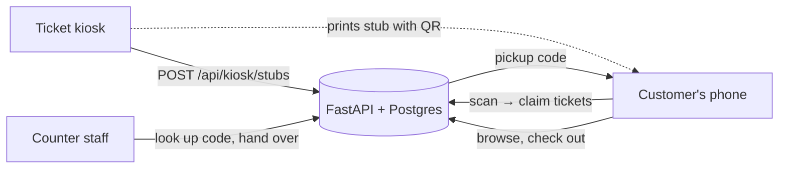

# Ticket2Prize

**Skip the line at the prize counter.** Arcade ticket machines print a stub with a QR code;
customers scan it, shop the prize catalog on their phone, check out with their tickets, and
pick everything up at the counter with a six-character code.

This started as my 2023 DevOps bootcamp capstone (the original statement of work and data-flow
diagram are in [`docs/2023-bootcamp`](docs/2023-bootcamp)). This is a ground-up rebuild of
that idea as a working, tested, deployable system.

| Phone: shop | Phone: pickup code | Counter: hand over |
| --- | --- | --- |
|  |  |  |

## How it works



1. **Kiosk** counts tickets and calls the API, which returns a one-time stub code. The QR on
   the printed stub links to `/claim/<code>`.
2. **Customer** scans it. Tickets land in a guest wallet, or their account if signed in.
   Guests can sign up later and keep their balance, so tickets can be saved for next visit.
3. **Checkout** deducts tickets and stock in one transaction and returns a pickup code.
4. **Staff** enter the code at the counter, see what to hand over, and mark it fulfilled
   (or cancel, which refunds the tickets and restocks the shelf).

## Stack

| | |
| --- | --- |
| **API** | Python 3.13, FastAPI, SQLAlchemy 2, Alembic, PostgreSQL 17 |
| **Web** | React 19, TypeScript, Vite, served by nginx |
| **Infra** | Terraform: VPC, ALB, ECS Fargate, RDS, Secrets Manager, CloudWatch |
| **CI/CD** | GitHub Actions: lint, test, scan, build, deploy to dev, gated promotion to prod |
| **Ops** | JSON logs, Prometheus `/metrics`, CloudWatch dashboard and alarms, autoscaling |

## Run it locally

With Docker:

```bash
docker compose up --build
```

Then open http://localhost:8080, print a stub at the [demo kiosk](http://localhost:8080/kiosk),
and follow the link on it. To try the counter view, create a staff account:

```bash
docker compose exec api python -m app.cli create-staff you@example.com 'a-long-password'
```

Without Docker (SQLite, hot reload):

```bash
cd backend && uv sync && uv run alembic upgrade head && uv run python -m app.seed
uv run uvicorn app.main:app --reload            # http://localhost:8000/docs
cd frontend && npm install && npm run dev        # http://localhost:5173
```

## Tests

```bash
cd backend && uv run pytest              # 34 tests; set TEST_DATABASE_URL for Postgres
cd frontend && npm test                  # Vitest + Testing Library
cd infra/modules/app && terraform test   # plan-level checks with a mocked AWS provider
scripts/smoke.sh http://localhost:8080   # against any running deployment
```

Two backend tests only run on Postgres (CI runs them every time). They fire 8 simultaneous
checkouts at the last prize in stock, and 8 simultaneous claims of one stub, and check that
exactly one wins.

## Deploying

`main` deploys itself: CI → images pushed to ECR → Terraform applies **dev** → smoke test
runs a real redemption → **production** waits for approval. Setup takes about 15 minutes.
See [docs/deploying.md](docs/deploying.md).

## More

- [Architecture and design decisions](docs/architecture.md)
- [Deployment guide](docs/deploying.md)

## Repository layout

```
backend/     FastAPI app, migrations, tests, Dockerfile
frontend/    React app, nginx config, tests, Dockerfile
infra/       bootstrap/ (state, ECR, OIDC) · modules/app/ · envs/{dev,prod}/
scripts/     smoke.sh
docs/        architecture, deployment, and the 2023 originals
```
