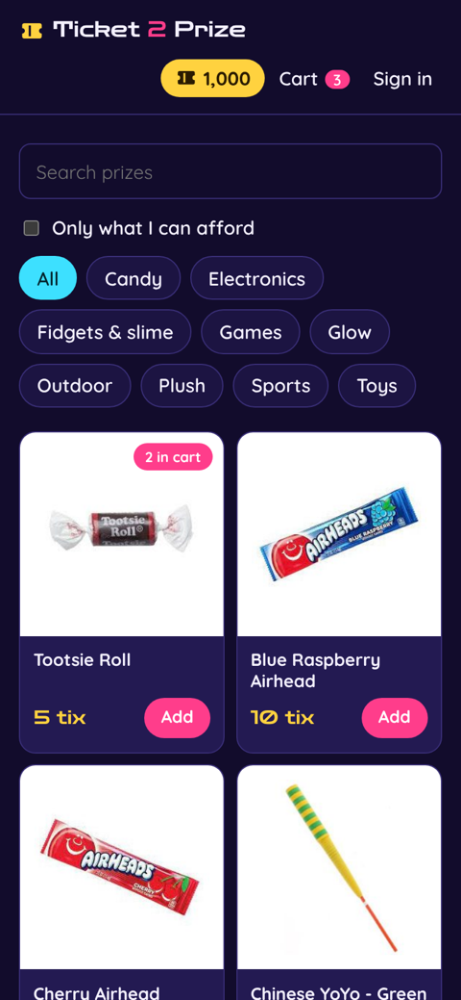
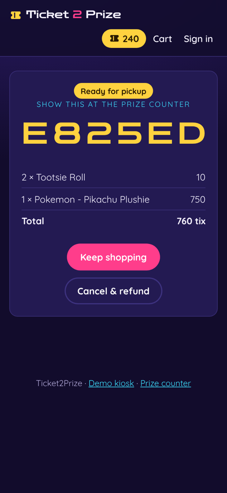
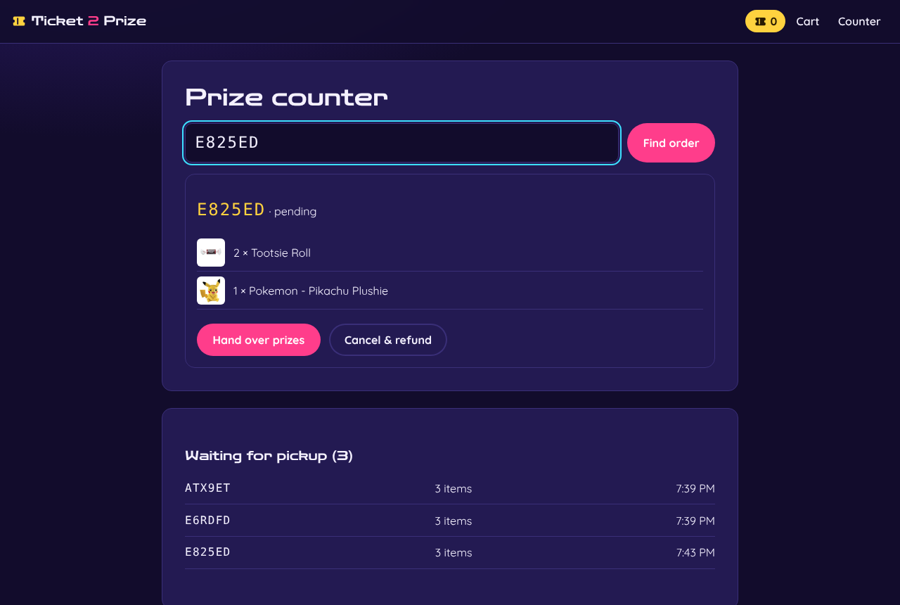
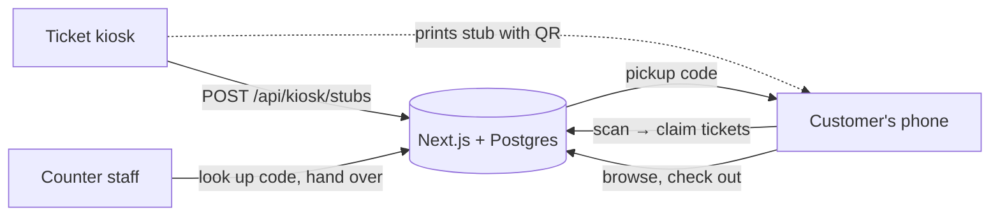

# Ticket2Prize

**Skip the line at the prize counter.** Arcade ticket machines print a stub with a QR code;
customers scan it, shop the prize catalog on their phone, check out with their tickets, and
pick everything up at the counter with a six-character code.

This started as my 2023 DevOps bootcamp capstone (the original statement of work and data-flow
diagram are in [`docs/2023-bootcamp`](docs/2023-bootcamp)). This is a ground-up rebuild of
that idea as a working, tested, deployable web app.

| Phone: shop | Phone: pickup code | Counter: hand over |
| --- | --- | --- |
|  |  |  |

## How it works



1. **Kiosk** counts tickets and calls the API, which returns a one-time stub code. The QR on
   the printed stub links to `/claim/<code>`.
2. **Customer** scans it. Tickets land in a guest wallet, or their account if signed in.
   Guests can sign up later and keep their balance, so tickets can be saved for next visit.
3. **Checkout** deducts tickets and stock in one transaction and returns a pickup code.
4. **Staff** enter the code at the counter, see what to hand over, and mark it fulfilled
   (or cancel, which refunds the tickets and restocks the shelf).

## Stack

One TypeScript app, one container, one database.

| | |
| --- | --- |
| **App** | Next.js 16 (App Router, server actions), React 19, TypeScript |
| **Data** | PostgreSQL 17 with Drizzle ORM and SQL migrations |
| **Infra** | Terraform: VPC, load balancer, ECS Fargate, RDS, Secrets Manager, CloudWatch |
| **CI/CD** | GitHub Actions: lint, test, scan, browser-test, deploy to dev, gated promotion to prod |
| **Ops** | JSON event logs, CloudWatch dashboard, metrics and alarms, autoscaling |

## Run it locally

With Docker:

```bash
docker compose up --build
```

Open http://localhost:3000, print a stub at the [demo kiosk](http://localhost:3000/kiosk)
(the kiosk key is `dev-kiosk-key`), and follow the link on it. To try the counter view, create
a staff account:

```bash
docker compose exec app node cli.mjs create-staff you@example.com 'a-long-password'
```

For development with hot reload, run just the database in Docker:

```bash
docker compose up -d db
npm install
npm run db:migrate && npm run db:seed
npm run dev                                      # http://localhost:3000
npm run cli -- create-staff you@example.com 'a-long-password'
```

## Tests

```bash
npm test                                 # 28 tests against Postgres (needs `docker compose up -d db`)
npx playwright test                      # 5 journeys × phone and desktop, against a running app
cd infra/modules/app && terraform test   # plan-level checks with a mocked AWS provider
scripts/smoke.sh http://localhost:3000   # quick checks against any deployment
```

Three of the tests are races. Eight buyers try for the last prize at once, eight phones scan
the same stub at once, and one wallet checks out from two tabs at once. Each time, exactly
one wins.

## Deploying

`main` deploys itself: CI → image pushed to ECR → Terraform applies **dev** → smoke and
browser tests run against it → **production** waits for approval. Setup takes about 15
minutes. See [docs/deploying.md](docs/deploying.md).

## Repository layout

```
src/app/         pages, server actions' UI, and API routes (kiosk, QR codes, health)
src/lib/         domain logic: stubs, wallets, orders, accounts, schema, sessions
src/cli.ts       admin commands: migrate, seed, create-staff
drizzle/         SQL migrations
e2e/             Playwright browser tests
infra/           bootstrap/ (state, ECR, OIDC) · modules/app/ · envs/{dev,prod}/
docs/            architecture, deployment, and the 2023 originals
```

More detail: [architecture and design decisions](docs/architecture.md).
