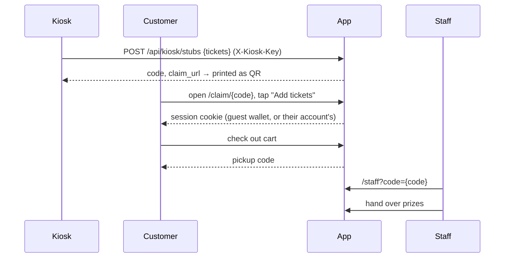
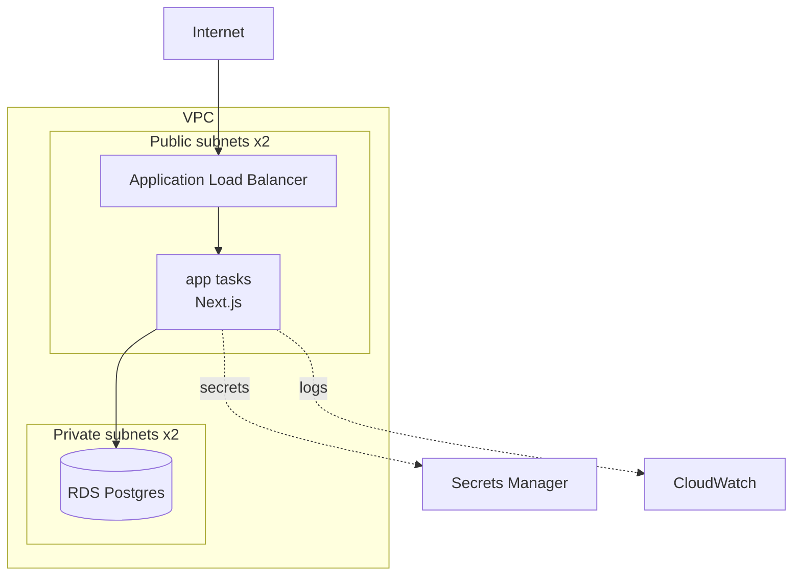

# Architecture

## Redemption flow

This follows the original 2023 data-flow diagram, with one change: guests can shop
immediately and decide later whether to keep an account. The diagram's "save for later" branch
becomes "create an account", and their wallet moves over with them.

## Data model

| Table | Purpose |
| --- | --- |
| `prizes` | Catalog and stock. `CHECK (stock >= 0)` |
| `wallets` | A ticket balance. `CHECK (balance >= 0)`. Guests have a wallet but no account |
| `accounts` | Email, password hash (Argon2), role (`customer` / `staff`), one wallet |
| `ticket_stubs` | Issued stubs. `claimed_at` is set once, ever |
| `orders`, `order_items` | Checkout, with the unit cost locked at time of purchase |
| `ledger_entries` | Append-only record of every balance change (stub, order, refund, merge) |

## Decisions worth explaining

**Balances and stock change through conditional updates, not read-modify-write.**
`UPDATE wallets SET balance = balance - 760 WHERE id = ? AND balance >= 760` either succeeds
or affects zero rows; there is no window where two requests both see enough tickets. Stock
and stub claims work the same way. Checkout does all of it in one transaction, so an
out-of-stock item rolls back the ticket deduction. The DB `CHECK` constraints are a second
line of defence. `src/lib/concurrency.test.ts` proves it against real Postgres.

**The stub code is the secret.** It's 16 random URL-safe characters (96 bits), so stubs
can't be guessed or enumerated, and claiming is one-shot. The 2023 prototype encoded
`TicketAmount=100` in the QR, which anyone could forge.

**Pickup codes are short and readable aloud.** Six characters from an alphabet without
0/O, 1/I/L. That's about 887 million combinations, and they only need to be unique.

**A ledger alongside the balance.** The balance column is what's checked at checkout; the
ledger explains how it got there. It's what you'd use to chase "shrink", which the original
SOW called out as a goal.

**Sessions are signed, HTTP-only cookies that name a wallet.** One session type covers
guests and accounts (the account id is an extra claim). Page scripts can't read the cookie,
so an injected script couldn't steal a session. Signing in from a guest session merges the
guest's tickets and orders into the account.

**One app, three ways in.** Pages are React server components that read Postgres directly.
Everything a person does (claim, check out, sign in, staff actions) is a server action that
checks the session itself, then calls a plain function in `src/lib`. A small HTTP API
remains for machines: the kiosk (`POST /api/kiosk/stubs`), stub QR codes, the public catalog
(`GET /api/prizes`) and health probes. The domain functions know nothing about Next.js,
which is why the tests can call them directly.

**Migrations run on boot, under a Postgres advisory lock.** Every app task runs
`node cli.mjs migrate` before starting the server. The lock means that when ECS starts several tasks at
once, one migrates and the rest wait. No separate migration job to orchestrate.

## Infrastructure

- **No NAT gateway.** Fargate tasks sit in public subnets with public IPs so they can pull
  images and reach AWS APIs; their security group only accepts traffic from the ALB. This
  saves about $32/month per AZ. The database is in private subnets with no internet route.
  For production at scale, move tasks to private subnets and add NAT or VPC endpoints.
- **Secrets never touch Terraform variables or the image.** RDS generates and rotates its
  own master password in Secrets Manager. The JWT key and kiosk key are generated by
  Terraform into a second secret. ECS injects both at container start.
- **Deploys roll back on their own.** ECS deployment circuit breakers revert to the last
  healthy task definition if new tasks fail health checks.
- **The app scales on CPU** (target 60%, 1–2 tasks in dev, 2–6 in prod).
- **CI deploys through GitHub OIDC.** No AWS keys are stored in GitHub. The deploy role
  trusts only this repo's `main` branch and its `dev`/`production` environments.

## Observability

- **Logs:** one JSON object per domain event (`stub_issued`, `stub_claimed`, `checkout`,
  `order_fulfilled`, `order_cancelled`) and per unexpected error, queryable directly in
  CloudWatch Logs Insights.
- **Metrics:** CloudWatch metric filters turn those events into business metrics:
  `StubsIssued`, `StubsClaimed`, `Checkouts`, `OrdersPickedUp`, `AppErrors`. The load
  balancer supplies request counts, status codes and response times.
- **Dashboard:** redemptions, traffic and errors, p50/p95/p99 response time, ECS CPU/memory,
  database load, and a live table of recent errors.
- **Alarms → SNS (email):** 5xx responses, unhealthy targets, p95 > 1s, DB CPU > 80%,
  DB storage < 2 GB.

## History

The first rebuild (October 2026) was a FastAPI backend plus a separate React single-page
app, two containers behind path-based routing. It was merged into this single Next.js app so
there's one language, one container and no API layer between the pages and the data. That
version is still in git history on the `rebuild` branch.
