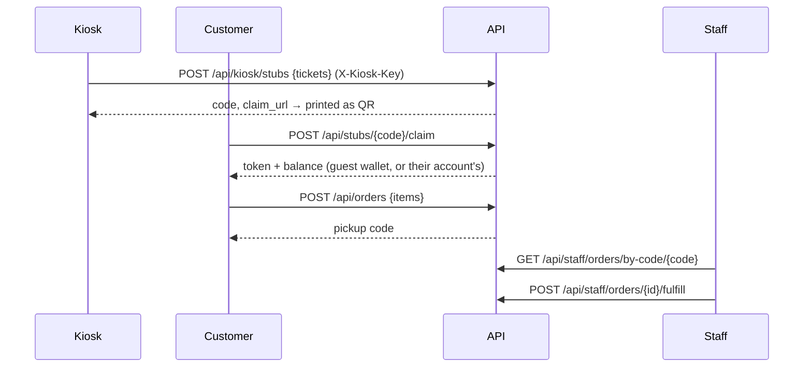
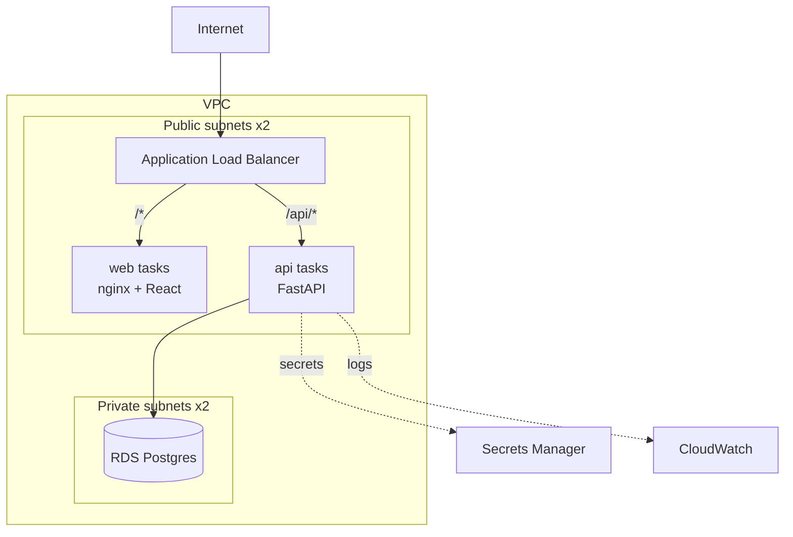

# Architecture

## Redemption flow

This follows the original 2023 data-flow diagram, with one change: guests can shop
immediately and decide later whether to keep an account. The diagram's "save for later" branch
becomes "create an account", and their wallet moves over with them.

## Data model

| Table | Purpose |
| --- | --- |
| `prizes` | Catalog and stock. `CHECK (stock >= 0)` |
| `wallets` | A ticket balance. `CHECK (balance >= 0)`. Guests have a wallet but no account |
| `accounts` | Email, password hash (Argon2), role (`customer` / `staff`), one wallet |
| `ticket_stubs` | Issued stubs. `claimed_at` is set once, ever |
| `orders`, `order_items` | Checkout, with the unit cost locked at time of purchase |
| `ledger_entries` | Append-only record of every balance change (stub, order, refund, merge) |

## Decisions worth explaining

**Balances and stock change through conditional updates, not read-modify-write.**
`UPDATE wallets SET balance = balance - 760 WHERE id = ? AND balance >= 760` either succeeds
or affects zero rows; there is no window where two requests both see enough tickets. Stock
and stub claims work the same way. Checkout does all of it in one transaction, so an
out-of-stock item rolls back the ticket deduction. The DB `CHECK` constraints are a second
line of defence. `tests/test_concurrency.py` proves it against real Postgres.

**The stub code is the secret.** It's 16 random URL-safe characters (96 bits), so stubs
can't be guessed or enumerated, and claiming is one-shot. The 2023 prototype encoded
`TicketAmount=100` in the QR, which anyone could forge.

**Pickup codes are short and readable aloud.** Six characters from an alphabet without
0/O, 1/I/L. That's about 887 million combinations, and they only need to be unique.

**A ledger alongside the balance.** The balance column is what's checked at checkout; the
ledger explains how it got there. It's what you'd use to chase "shrink", which the original
SOW called out as a goal.

**Tokens are JWTs that name a wallet.** One token type covers guests and accounts (the
account id is an extra claim). Signing in with a guest token merges the guest's tickets and
orders into the account.

**Migrations run on boot, under a Postgres advisory lock.** Every API task runs
`alembic upgrade head` before starting. The lock means that when ECS starts several tasks at
once, one migrates and the rest wait. No separate migration job to orchestrate.

## Infrastructure

- **No NAT gateway.** Fargate tasks sit in public subnets with public IPs so they can pull
  images and reach AWS APIs; their security group only accepts traffic from the ALB. This
  saves about $32/month per AZ. The database is in private subnets with no internet route.
  For production at scale, move tasks to private subnets and add NAT or VPC endpoints.
- **Secrets never touch Terraform variables or the image.** RDS generates and rotates its
  own master password in Secrets Manager. The JWT key and kiosk key are generated by
  Terraform into a second secret. ECS injects both at container start.
- **Deploys roll back on their own.** ECS deployment circuit breakers revert to the last
  healthy task definition if new tasks fail health checks.
- **The API scales on CPU** (target 60%, 1–2 tasks in dev, 2–6 in prod).
- **CI deploys through GitHub OIDC.** No AWS keys are stored in GitHub. The deploy role
  trusts only this repo's `main` branch and its `dev`/`production` environments.

## Observability

- **Logs:** one JSON object per request (`request_id`, `method`, `path`, `status`,
  `duration_ms`), queryable directly in CloudWatch Logs Insights.
- **Metrics:** CloudWatch metric filters turn those logs into business metrics:
  `StubsIssued`, `StubsClaimed`, `Checkouts`, `ServerErrors`. The API also serves Prometheus
  metrics at `/metrics`, which isn't routed through the ALB. Scrape it with an ADOT sidecar
  if you add Prometheus.
- **Dashboard:** redemptions, API traffic and errors, p50/p95/p99 latency, ECS CPU/memory,
  database load, and a live table of recent errors.
- **Alarms → SNS (email):** API 5xx, unhealthy targets, p95 > 1s, DB CPU > 80%, DB storage < 2 GB.
